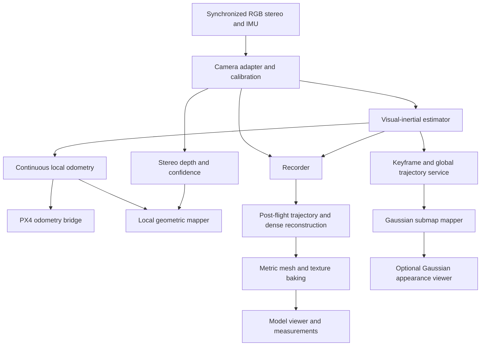

# Drone-based 3D Mapper - Technical Blueprint

Status: implementation proposal. Research cutoff: October 26, 2026.

This consolidates the preceding research. Published specifications and performance are author/vendor claims; no system was compiled or flight-tested during that research. Engineering targets below are proposed acceptance criteria, not demonstrated capabilities. The source catalog preserves links cited throughout the discussion, including alternatives.

## 1. Objective and decisions

Build an X650-based aerial drone development platform that provides continuous local odometry to PX4, records synchronized RGB/inertial data, and delivers a navigable, measurable 3D model with realistic surfaces. The primary product is a metric textured triangle mesh; a colored point cloud and validation report accompany it. Gaussian splats are an optional appearance product.

Here, navigable means a user can orbit, fly through or walk through the reconstructed model. Autonomous aircraft navigation remains a separate function using the local geometric map. Measurement uses validated surface geometry in meters, not Gaussian centers or texture pixels. The final high-quality model is produced post-flight on a workstation; onboard geometry is a preview/navigation product.

Implement in this order:

1. Deterministic recording and replay.
2. Calibrated stereo-inertial odometry and PX4 integration.
3. Confidence-filtered stereo depth and local occupancy/distance mapping.
4. Post-flight trajectory refinement, dense reconstruction, meshing and texture baking.
5. Model viewer with geometric measurement and quality overlays.
6. A second stereo unit, after the first rig passes validation.
7. Optional Gaussian mapping after the mesh deliverable passes validation.

Navigation must remain operational when Gaussian mapping is disabled, stalled, or restarted. Gaussian opacity is not occupancy probability. Render quality is not proof of metric geometry.

## 2. Hardware baseline

| Item              | Initial choice                        | Integration requirement                                                                                            |
| ----------------- | ------------------------------------- | ------------------------------------------------------------------------------------------------------------------ |
| Airframe          | Holybro X650 Development Kit          | Confirm actual revision, battery, takeoff mass, mount clearances, and center of gravity                            |
| Flight controller | PX4 on selected controller            | Standard kit offers Pixhawk 6C/6X; retain Cube Orange only if explicitly selected and supported by chosen firmware |
| Companion         | Jetson Orin NX 16 GB                  | Confirm carrier, thermal solution, camera capture support, and sustained power mode                                |
| Camera            | One forward-facing ZED X              | Dual RGB global shutters, 12 cm baseline, integrated IMU; camera mass 239 g                                        |
| Capture           | Compatible ZED Link GMSL2 card        | Validate exact carrier/card/cable/JetPack/SDK combination before purchase                                          |
| Storage           | NVMe                                  | Size from measured sustained recording throughput and mission duration                                             |
| Power             | Dedicated regulated perception supply | Engineer against 6S battery voltage range, measured peak load, and brownout behavior                               |
| GNSS              | Kit GNSS initially; RTK optional      | Calibrate antenna lever arm and record status/correction quality if added                                          |

ZED X Mini is the compact alternative: 151 g, 5 cm baseline. HAWK is the Isaac ROS-oriented alternative: dual RGB global shutters, 15 cm baseline, approximately 204 g. OAK-D Pro W OV9782 is a close-range RGB-D alternative, but its depth stereo pair is monochrome. [S01–S07]

Holybro lists 2.0 kg kit mass without battery, a 6.3 kg takeoff-weight limit, and approximately 3.1 kg additional payload with the specified 1.2 kg battery. Its 30-minute hover claim excludes additional payload. Treat these as vendor figures; establish endurance experimentally. [S01]

Mount cameras rigidly with their navigation IMU, clear of propellers and landing gear. Begin without a gimbal. Measure vibration with motors running. Do not substitute untimed flight-controller IMU telemetry for a calibrated camera–IMU assembly.

## 3. System architecture



Maintain four products:

- **Local odometry:** continuous, metric, latency-sensitive pose and velocity.
- **Geometry:** local occupancy/TSDF/ESDF with explicit unknown space and confidence filtering.
- **Final model:** globally refined metric triangle mesh with UV textures, supporting point cloud, and accuracy/coverage report.
- **Optional appearance:** Gaussian submaps for rendering. These do not define the measurement surface.

Use one authoritative pose producer per output stream. If the ZED SDK supplies images/depth while OKVIS2-X supplies odometry, do not also fuse ZED positional tracking as an independent measurement without modeling correlation.

## 4. Estimator and mapper selection

### Navigation

Baseline candidate: **OKVIS2-X**, initially stereo-inertial, with Gaussian mapping external to its estimator. It provides a documented multi-camera configuration, loop closure, optional GNSS/depth/LiDAR pathways, and ROS 2 integration. Benchmark **cuVSLAM** as an alternative after verifying support for the exact camera acquisition path and selected inertial mode. Do not assume ZED-to-cuVSLAM integration is turnkey. [S08–S13]

OpenVINS is a useful lighter VIO reference; ORB-SLAM3, VINS-Fusion, and GVINS provide additional comparison points. Their presence does not imply equivalent arbitrary-camera or ROS 2 integration. [S14–S18]

### Optional Gaussian mapping

| Candidate                | Use in this project                                                          | Qualification                                                                                                                    |
| ------------------------ | ---------------------------------------------------------------------------- | -------------------------------------------------------------------------------------------------------------------------------- |
| Photo-SLAM               | Reproduce baseline and inspect event-driven geometry-to-Gaussian integration | Released mapper modes are mono/stereo/RGB-D; inertial ORB code does not establish integrated Photo-SLAM VIO                      |
| CaRtGS                   | First mapping-efficiency comparison                                          | ORB-SLAM3-based; adaptive optimization, faster backward pass, opacity regularization                                             |
| MCGS-SLAM                | Multi-camera RGB reconstruction experiment                                   | Documented multi-camera BA/depth-scale alignment; desktop reference setup; IMU capability not established by documented pipeline |
| VIGS-SLAM                | Integrated RGB–IMU research comparison                                       | Joint inertial/visual optimization and loop-consistent Gaussian updates; embedded performance unverified here                    |
| VINGS-Mono               | Large-scene RGB–IMU comparison                                               | Different project from VIGS-SLAM; study memory management and loop correction                                                    |
| Splat-SLAM / WildGS-SLAM | Global consistency / dynamic-scene references                                | Evaluate neural inference cost before embedded adoption                                                                          |
| VIGS-Fusion              | Embedded deployment reference if RGB-D is adopted                            | Authors report Orin NX 16 GB, 424×240, 14 FPS; experimental code                                                                 |
| Gaussian-LIC2            | Alternative if LiDAR is allowed                                              | Changes sensor/payload assumptions                                                                                               |

Sources: [S19–S39]. None is assumed to be a drop-in backend for OKVIS2-X. A custom mapper adapter or a separate reproduction pipeline is required.

## 5. Coordinate frames and time

Use REP-103 conventions inside ROS and explicitly convert at the PX4 boundary.

| Frame           | Meaning                                                                |
| --------------- | ---------------------------------------------------------------------- |
| `map`           | Globally corrected reconstruction frame; may change relative to `odom` |
| `odom`          | Continuous local estimation frame                                      |
| `base_link`     | Defined vehicle reference, x forward / y left / z up                   |
| `imu_link`      | Camera assembly IMU frame                                              |
| `cam_i_optical` | Camera i, x right / y down / z forward                                 |

Notation: `T_A_B` maps coordinates from B into A. Compute each camera pose using `T_W_Ci = T_W_B * T_B_Ci`. Calibration storage must state transform direction and units.

Publish a single consistent `map -> odom -> base_link` chain. Keep discrete global corrections in `map -> odom`; do not send loop-closure pose jumps directly as continuous flight odometry. An estimator adapter must provide or construct this separation; verify its behavior against the chosen estimator release.

Retain acquisition timestamps, clock domain, sequence numbers, and exposure metadata. Define whether image timestamps represent exposure start or midpoint. Map sensor time into the ROS time domain without replacing acquisition time with callback arrival time. Preserve original time in recordings.

Initial camera synchronization target: <0.5 ms, tightened with motion. Example: at 500 px focal length and 200 degrees/s rotation, 1 ms timing error gives approximately 1.75 px displacement. A software timestamp tolerance is not a physical synchronization guarantee.

## 6. ROS 2 modules and data contracts

The following package and topic names are proposed project interfaces, not existing third-party APIs.

| Package                  | Responsibility                                                                                | Main output                                       |
| ------------------------ | --------------------------------------------------------------------------------------------- | ------------------------------------------------- |
| `x650_description`       | URDF, calibrated transforms, mounting reference                                               | Static TF                                         |
| `x650_camera`            | Wrap vendor acquisition, retain metadata, provide calibrated images/IMU                       | Images, CameraInfo, Imu                           |
| `x650_estimator_adapter` | Normalize estimator output, health, covariance, reset and global-correction behavior          | Local odometry + global pose updates              |
| `x650_px4_bridge`        | Frame/time conversion and external odometry transport                                         | PX4 external vision input                         |
| `x650_depth`             | Stereo/SDK depth conversion, confidence and invalid masks                                     | Metric depth + validity                           |
| `x650_geometry`          | Local geometric fusion and distance queries                                                   | TSDF/occupancy/ESDF                               |
| `x650_keyframes`         | Select and persist synchronized views and pose revisions                                      | Keyframe manifest + events                        |
| `x650_reconstruction`    | Post-flight camera/trajectory refinement, dense geometry, meshing and texturing orchestration | Metric mesh, point cloud, reconstruction manifest |
| `x650_model_export`      | Texture/geometry packaging, coordinate metadata, validation and display LODs                  | GLB, reference mesh, report                       |
| `x650_model_viewer`      | Orbit/fly/walk controls, surface picking, distance and area tools, coverage overlays          | Navigable model and saved measurements            |
| `x650_gaussian`          | Optional offline first, then asynchronous submap optimization                                 | Gaussian artifacts + mapper health                |
| `x650_recording`         | Capture raw inputs, calibration, configuration and diagnostics                                | Replayable session                                |
| `x650_bringup`           | Parameter files and launch composition                                                        | Repeatable configurations                         |
| `x650_evaluation`        | Alignment, metrics, runtime reports, fault injection                                          | Machine-readable results                          |

Suggested interfaces:

| Topic                    | Type / semantics                                                                        |
| ------------------------ | --------------------------------------------------------------------------------------- |
| `/rig/cam_i/image_raw`   | `sensor_msgs/Image`, acquisition timestamp                                              |
| `/rig/cam_i/camera_info` | `sensor_msgs/CameraInfo`, matching acquisition model                                    |
| `/rig/imu`               | `sensor_msgs/Imu`, calibrated units and explicitly defined covariances                  |
| `/vio/odometry`          | `nav_msgs/Odometry`, parent `odom`, child `base_link`, continuous local pose            |
| `/vio/health`            | Diagnostics: initialization, tracking quality, reset counter, last measurement age      |
| `/stereo/depth`          | `sensor_msgs/Image`, project-standard `32FC1` meters, invalid values explicitly defined |
| `/stereo/confidence`     | Confidence/mask image; record vendor scale and conversion policy                        |
| `/mapping/keyframe`      | Custom event referencing persisted image bundle and pose revision                       |
| `/mapping/pose_updates`  | Custom batch: affected keyframe IDs, corrected poses, revision                          |
| `/mapping/health`        | Queue age, active submaps, Gaussian count, optimization time and memory                 |

Estimator image conventions and supported camera models must be checked before wiring topics. Raw and rectified images need distinct topic names and CameraInfo. Never apply distortion correction twice.

Use bounded queues. Camera streams should use compatible sensor-data QoS; keyframe events require durable persisted assets or explicit delivery/recovery logic. Do not transport all full-resolution RGB views in high-rate custom mapping messages.

## 7. PX4 boundary

Choose one transport after pinning the PX4 release:

- **ROS 2:** publish the release-compatible `px4_msgs/VehicleOdometry` external vision input through the documented PX4 ROS 2 bridge.
- **MAVLink:** send `ODOMETRY` using the supported external estimation interface.

Confirm exact topic availability, message definitions, timestamp semantics, firmware configuration, and ROS/PX4 version compatibility against that release. Do not copy ArduPilot ExternalNav parameters into PX4. [S40–S43, S54–S55]

Adapter requirements:

1. Convert ROS ENU/FLU and camera frames into the PX4-required pose/velocity frames.
2. Populate orientation, velocity, covariance/variance fields and quality/reset information supported by the selected interface.
3. Account for sensor lever arm and measurement latency.
4. Reject stale/invalid estimates and report loss of vision to the supervisor.
5. Configure EKF2 external-vision fusion against the pinned release.
6. Verify GNSS/vision interaction and global corrections before enabling flight dependence.

Validate axis signs, yaw, timestamp behavior, covariance consistency, dropouts, and resets in simulation and on the ground. Initial target: visual updates >=30 Hz and p95 capture-to-odometry age <50 ms, subject to flight dynamics. IMU-propagated output must be distinguished from newly vision-corrected output.

## 8. Calibration deliverables

Use Kalibr where supported, plus vendor calibration as an initial reference. [S45]

Deliver and version:

- Camera intrinsics/distortion at each operating crop/resolution.
- Stereo and full-rig extrinsics, with convention and units.
- Camera-to-IMU spatial and temporal calibration.
- IMU noise density, random walk, saturation and bias characterization.
- Camera/IMU assembly to vehicle reference transform.
- GNSS antenna lever arm if applicable.
- Independent validation recording and calibration report.

Lock focus; document exposure/gain behavior. Revalidate after remounting or impacts and across operating temperature. A second stereo unit requires a shared rig calibration and verified inter-unit synchronization.

## 9. Optional Gaussian mapper contract

Implement a dataset adapter before a live mapper. Initial inputs are RGB views, calibration, metric keyframe poses, and optional confidence-filtered depth/sparse landmarks.

Persist each keyframe bundle with:

```text
session_id, rig_id, keyframe_id, timestamp, clock_domain
calibration_hash, pose_revision, T_odom_base, T_map_base
views[]: camera_id, image_path, camera_model, T_base_camera,
         exposure_metadata, optional_depth_path, optional_confidence_path
optional_sparse_landmarks, estimator_quality
```

Represent each Gaussian submap in its own anchored frame. Store anchor keyframe ID and pose revision. For a rigid anchor correction, update the submap transform; when internal geometry changes, refine or rebuild affected content. One rigid transform cannot fix arbitrary internal drift. Handle overlapping submap duplicates and seams explicitly.

Initial mapper controls:

- Fixed active-submap and keyframe-cache budgets.
- Maximum Gaussian count and measured memory ceiling.
- Limited optimization work per scheduling interval.
- Confidence/depth filtering and moving-object masks where available.
- Drop redundant keyframes before allowing unbounded backlog.
- Pause mapping under odometry latency, thermal, or memory pressure.
- Save periodic map checkpoints and pose revisions.

Export Gaussian PLY or backend-native data, trajectory, calibration, manifest, runtime logs, and a held-out-view rendering set. Keep final offline refinement results separate from end-of-flight results.

## 10. Geometry and compute budgets

Use confidence-filtered stereo depth to drive a local nvblox or comparable geometric mapper. Preserve unknown space; invalid depth must not clear obstacles. Aerial planning needs 3D distance/occupancy queries, not only a ground-robot 2D costmap. [S46–S48]

Depth uncertainty approximately follows `sigma_Z = Z^2 * sigma_d / (f * B)`. At f=500 px, B=0.15 m, sigma_d=0.5 px, uncertainty is approximately 0.17 m at 5 m, 0.67 m at 10 m, and 2.67 m at 20 m. This excludes calibration and other errors. Select mission distance and geometric acceptance criteria accordingly.

Measure all stages under sustained operation: acquisition, rectification, estimator, depth, geometric fusion, recording, and Gaussian training. INT8 inference TOPS do not predict Gaussian training throughput. NX unified memory must cover the entire stack. [S49]

Recording estimate: four 1280×720 cameras at 30 Hz require approximately 111 MB/s at one byte/pixel or 332 MB/s as RGB8 before overhead. Choose raw/compressed formats by measured loss, CPU load, and storage bandwidth while preserving timestamps.

Do not assume Photo-SLAM's AGX Orin 64 GB MAXN demonstration transfers to Orin NX. Its older dependency stack should be isolated from the navigation environment until compatibility is established. [S19]

## 11. Implementation milestones

| Milestone                     | Coding work                                                                       | Exit criterion                                                                                         |
| ----------------------------- | --------------------------------------------------------------------------------- | ------------------------------------------------------------------------------------------------------ |
| M0: dependency lock           | Record hardware SKUs and exact PX4, JetPack, ROS, SDK and estimator revisions     | Camera, IMU and bridge smoke tests pass independently on target hardware                               |
| M1: record/replay             | Camera wrapper, timestamp audit, session manifest, calibration loader             | Repeatable replay; frame pairing and timing verified; sustained recording without unexplained loss     |
| M2: VIO baseline              | Estimator adapter, TF, quality and reset reporting                                | Metric scale and axis checks pass; evaluate closed-loop handheld trajectories                          |
| M3: PX4 SITL                  | Odometry bridge, simulated dropouts/resets/latency                                | Correct axes and timing; stale-data behavior works; global correction does not jump local odometry     |
| M4: geometry                  | Confidence depth adapter and local map                                            | Validate known obstacles, unknown regions and depth-range limits                                       |
| M5: final metric model        | Refined trajectory/rig export, dense reconstruction, mesh and texture pipeline    | Point cloud and textured mesh share a metric frame; independent accuracy and coverage report           |
| M6: navigable model           | GLB packaging, reference-geometry picking, measurement tools and quality overlays | Known-distance tests pass; display LOD does not change reference measurements; invalid regions flagged |
| M7: flight validation         | Ground motor tests, controlled hover, incremental mission tests                   | Stable estimates under real vibration; logs reviewed before expanding flight envelope                  |
| M8: second stereo rig         | Camera IDs, multi-camera acquisition, extrinsics and bundle selection             | Physical synchronization verified; measurable coverage benefit under fixed compute budget              |
| M9: optional Gaussian mapping | Offline comparison, then bounded onboard worker                                   | Mesh product remains independent; navigation latency, memory and queues stay bounded                   |

Start coding M0–M2 without waiting for online Gaussian integration. Keep estimator/mapping experiments reproducible from the same recordings.

First implementation sprint:

1. Create the ROS 2 workspace and the description, recording, camera, estimator-adapter and evaluation packages.
2. Add configuration schemas for hardware revision, calibration hash, clock policy and dependency versions.
3. Record one stationary sequence and one handheld six-axis/closed-loop sequence.
4. Replay through the estimator; save trajectory, timing, initialization and reset diagnostics.
5. Implement transform/time conversion tests before connecting the PX4 bridge.
6. Produce one machine-readable baseline report and freeze the recording as a regression fixture.

## 12. Benchmark and test protocol

| Data                | Purpose                                                                                                     |
| ------------------- | ----------------------------------------------------------------------------------------------------------- |
| Replica / TUM RGB-D | Reproduce appearance baselines using original evaluation protocols [S19, S50]                               |
| EuRoC MAV           | Stereo-inertial initialization and motion; monochrome imagery is unsuitable for RGB appearance claims [S51] |
| Oxford Spires       | Multi-camera color/IMU, outdoor trajectories and reference geometry [S52]                                   |
| Hilti-Oxford        | Multi-camera robustness, feature-poor construction scenes and revisits [S53]                                |
| X650 recordings     | Motor vibration, yaw, exposure changes, thermal load, sensor dropout and mission conditions                 |

Report localization ATE/RPE, scale drift, failures and recovery; geometric accuracy/completeness versus range; thin-obstacle detection; held-out PSNR/SSIM/LPIPS; p50/p95/p99 capture-to-output latency; frame loss and queue age; peak memory, power and temperature.

Use SE(3) alignment for metric systems; disclose Sim(3) alignment separately for scale-ambiguous monocular results. Compare identical sensor inputs, resolutions, hardware, sequence duration and optimization budgets. Repeat nondeterministic runs and report failures rather than excluding them.

Required integration tests: transform round trips, known-axis motions, timestamp conversion, missing/late stereo frames, IMU gaps, estimator resets, global pose corrections, invalid depth, full storage, mapper crash, memory pressure, and replay consistency. Use SITL before making flight control depend on external odometry.

Initial gates: >=30 Hz visual updates, p95 age <50 ms, no unhandled resets over the target mission, bounded memory/queues, and successful loss-of-vision handling. Geometry accuracy and mission endurance gates must be set after choosing operating distance, speed, and battery. Product release also requires the model acceptance checks in Section 15.

## 13. Outstanding decisions

Before procurement: confirm controller, battery, payload mounting, camera lens/FOV, Jetson carrier/capture support, regulated power and cooling.

Before flight: pin firmware/ROS interfaces, decide GNSS versus vision fusion policy, establish mission speed/distance/clearance, and validate failure handling.

Before distributing a product: audit all dependency and model-weight licenses. Photo-SLAM combines GPL-covered code with included Gaussian-Splatting research/evaluation restrictions; a repository-level license label is insufficient. [S19, S25]

## 14. Source catalog

All entries below preserve sources cited in the preceding discussion. Links to moving branches document the research view; pin commits and document versions during M0. Alternative systems are retained for traceability, not endorsed as deployment-ready.

- **S01** [Holybro X650 Development Kit: specifications, payload, controller options](https://holybro.com/products/x650-development-kit)
- **S02** [ZED X / X Mini / X Nano specifications](https://docs.stereolabs.com/docs/products/cameras/zedx/specifications)
- **S03** [Stereolabs shutter types and synchronization](https://support.stereolabs.com/articles/9796499033-what-kind-of-the-shutter-mode-do-the-zed-cameras-use-is-it-a-rolling-shutter-or-a-global-shutter)
- **S04** [Leopard Imaging HAWK datasheet](https://leopardimaging.com/wp-content/uploads/2024/04/LI-AGO-ADP-HAWK-D_Datasheet.pdf)
- **S05** [Luxonis OAK-D Pro W variants and specifications](https://checkout.luxonis.com/products/oak-d-pro-w)
- **S06** [Arducam external-trigger documentation](https://docs.arducam.com/Raspberry-Pi-Camera/Global-Shutter-Camera/external-trigger/)
- **S07** [Xsens MTi-610 documentation](https://www.movella.com/hubfs/Downloads/Leaflets/MTi-610.pdf)
- **S08** [OKVIS2-X repository](https://github.com/ethz-mrl/OKVIS2-X)
- **S09** [OKVIS2-X five-camera/IMU configuration](https://github.com/ethz-mrl/OKVIS2-X/blob/main/config/hilti22/okvis2.yaml)
- **S10** [cuVSLAM repository and sensor modes](https://github.com/nvidia-isaac/cuVSLAM)
- **S11** [Isaac ROS cuVSLAM API](https://nvidia-isaac-ros.github.io/repositories_and_packages/isaac_ros_visual_slam/isaac_ros_cuvslam/index.html)
- **S12** [cuVSLAM official troubleshooting](https://github.com/nvidia-isaac/cuVSLAM/blob/main/TROUBLESHOOTING.md)
- **S13** [Photo-SLAM ORB-SLAM3 optimizer source](https://github.com/HuajianUP/Photo-SLAM/blob/main/ORB-SLAM3/src/Optimizer.cc)
- **S14** [OpenVINS documentation](https://docs.openvins.com/)
- **S15** [VINS-Fusion repository](https://github.com/HKUST-Aerial-Robotics/VINS-Fusion)
- **S16** [GVINS repository](https://github.com/HKUST-Aerial-Robotics/GVINS)
- **S17** [Photo-SLAM ORB-SLAM3 tracking source](https://github.com/HuajianUP/Photo-SLAM/blob/main/ORB-SLAM3/src/Tracking.cc)
- **S18** [Photo-SLAM EuRoC stereo executable](https://github.com/HuajianUP/Photo-SLAM/blob/main/examples/euroc_stereo.cpp)
- **S19** [Photo-SLAM repository and prerequisites](https://github.com/HuajianUP/Photo-SLAM) · [prerequisites anchor](https://github.com/HuajianUP/Photo-SLAM#prerequisites)
- **S20** [Photo-SLAM paper, technical pipeline, benchmarks and supplement](https://arxiv.org/html/2311.16728v2)
- **S21** [Photo-SLAM Gaussian mapper source](https://github.com/HuajianUP/Photo-SLAM/blob/main/src/gaussian_mapper.cpp)
- **S22** [Photo-SLAM Gaussian model source](https://github.com/HuajianUP/Photo-SLAM/blob/main/src/gaussian_model.cpp)
- **S23** [Photo-SLAM mapper interface and sensor enumeration](https://github.com/HuajianUP/Photo-SLAM/blob/main/include/gaussian_mapper.h)
- **S24** [MonoGS repository](https://github.com/muskie82/MonoGS)
- **S25** [Photo-SLAM included Gaussian-Splatting license](https://github.com/HuajianUP/Photo-SLAM/blob/main/LICENSE.md)
- **S26** [SplaTAM repository](https://github.com/spla-tam/SplaTAM)
- **S27** [MM3DGS-SLAM repository](https://github.com/VITA-Group/MM3DGS-SLAM)
- **S28** [RTG-SLAM paper](https://arxiv.org/abs/2404.19706) · [code](https://github.com/MisEty/RTG-SLAM)
- **S29** [CaRtGS project and code links](https://dapengfeng.github.io/cartgs/)
- **S30** [Splat-SLAM repository](https://github.com/google-research/Splat-SLAM)
- **S31** [WildGS-SLAM project](https://wildgs-slam.github.io/)
- **S32** [VINGS-Mono paper](https://arxiv.org/html/2501.08286v1)
- **S33** [VINGS-Mono repository](https://github.com/Fudan-MAGIC-Lab/VINGS-Mono)
- **S34** [MCGS-SLAM project](https://mcgs-slam.github.io/)
- **S35** [MCGS-SLAM repository](https://github.com/mcgs-slam/mcgs-slam)
- **S36** [VIGS-SLAM project](https://vigs-slam.github.io/) · [code](https://github.com/cvg/VIGS-SLAM)
- **S37** [VIGS-Fusion author-uploaded paper](https://www.researchgate.net/publication/404399806_VIGS-Fusion_Fast_Gaussian_Splatting_SLAM_processed_onboard_a_small_quadrirotor)
- **S38** [VIGS-Fusion repository and experimental-software notice](https://github.com/AbdoullahNdoye/VIGS-Fusion)
- **S39** [Gaussian-LIC / LIC2 repository](https://github.com/APRIL-ZJU/Gaussian-LIC) · [LIC2 paper](https://arxiv.org/abs/2507.04004)
- **S40** [PX4 external position-estimation interface, v1.15](https://docs.px4.io/v1.15/en/ros/external_position_estimation)
- **S41** [PX4 VIO integration guidance, main](https://docs.px4.io/main/en/computer_vision/visual_inertial_odometry)
- **S42** [ArduPilot companion computers — alternative firmware reference](https://ardupilot.org/copter/docs/common-companion-computers.html)
- **S43** [ArduPilot external navigation — alternative firmware reference](https://ardupilot.org/dev/docs/mavlink-nongps-position-estimation.html)
- **S44** [u-blox ZED-F9P RTK receiver specifications](https://www.u-blox.com/en/product/zed-f9p-module?legacy=Cu)
- **S45** [Kalibr calibration toolbox](https://github.com/ethz-asl/kalibr)
- **S46** [nvblox library](https://github.com/nvidia-isaac/nvblox)
- **S47** [nvblox supported platforms and installation](https://nvidia-isaac.github.io/nvblox/v0.0.10/pages/installation.html)
- **S48** [Isaac ROS nvblox integration](https://github.com/NVIDIA-ISAAC-ROS/isaac_ros_nvblox)
- **S49** [NVIDIA Jetson Orin power/performance documentation](https://docs.nvidia.com/jetson/archives/r36.5/DeveloperGuide/SD/PlatformPowerAndPerformance/JetsonOrinNanoSeriesJetsonOrinNxSeriesAndJetsonAgxOrinSeries.html)
- **S50** [Photo-SLAM paper evaluation reference](https://arxiv.org/html/2311.16728v2) — same publication as S20, retained for benchmark traceability
- **S51** [EuRoC MAV dataset](https://projects.asl.ethz.ch/datasets/euroc-mav/)
- **S52** [Oxford Spires dataset](https://dynamic.robots.ox.ac.uk/datasets/oxford-spires/)
- **S53** [Hilti-Oxford dataset](https://hilti-challenge.com/dataset-2022)
- **S54** [PX4 ROS 2 user guide and version compatibility](https://docs.px4.io/main/en/ros2/user_guide)
- **S55** [PX4 VehicleOdometry message definition](https://docs.px4.io/main/en/msg_docs/VehicleOdometry)
- **S56** [COLMAP reconstruction tutorial](https://colmap.github.io/tutorial.html)
- **S57** [OpenMVS dense reconstruction, meshing and texturing](https://github.com/cdcseacave/openMVS)
- **S58** [Khronos glTF scene/model delivery format](https://www.khronos.org/gltf/)

## 15. Primary product: metric textured surface model

### Reconstruction workflow

1. Select sharp, well-exposed RGB views with sufficient overlap and parallax; retain original resolution and calibration. Use repeat views and oblique passes to capture walls, recesses, and roofs. Start planning around 80% forward / 70% lateral overlap as a tunable acquisition target; verify actual surface visibility rather than relying on percentages. Avoid pure rotation and repeated near-identical frames.
2. Refine global camera poses with image correspondences, calibrated rig constraints and suitable metric controls. Use VIO as initialization, not unquestioned final truth. Preserve physical stereo scale; if importing to an unconstrained SfM stage, restore and validate scale explicitly. Use surveyed controls/RTK constraints if available, with independent checkpoints withheld from optimization.
3. Reconstruct dense geometry from multi-view stereo, or fuse confidence-filtered stereo depth using the corrected per-image poses. Reintegrate depth if poses change; a local real-time TSDF should not be treated automatically as the final globally corrected surface.
4. Extract a triangle mesh; remove unsupported floaters and refine surfaces against observations. Preserve thin structures where evidenced. Keep holes or mark interpolated regions explicitly; do not manufacture measurement surfaces through automatic hole filling.
5. Select source images, unwrap UVs, and bake/blend textures while managing occlusion, exposure differences and seams. Vertex RGB alone does not satisfy the textured-mesh deliverable. Surface texture can contain baked lighting and is not guaranteed to represent intrinsic material reflectance.
6. Produce reference geometry and display LODs; validate that simplification and export do not introduce unacceptable geometric error. Publish a viewer asset and archive the source geometry, source observations, transforms and quality report.

Candidate implementation: COLMAP for image-based pose/dense reconstruction and OpenMVS for dense cloud, mesh reconstruction/refinement and texturing. Begin with a small recorded dataset and validate the pinned versions' import formats, rig handling and metric-scale preservation before automating. A TSDF-derived mesh textured from calibrated RGB views is an alternative prototype path; TSDF extraction alone does not provide UV textures. These are proposed integration paths, not an already-tested pipeline. [S56–S57]

Run final reconstruction on a workstation initially. Keep its dependency environment separate from flight software. The existing ZED X is a starting sensor; evaluate reference-object errors at mission range before committing to acquisition hardware. Higher-resolution imagery, longer effective baselines through flight motion, or LiDAR may be needed for the eventual tolerance.

### Delivered package

```text
model/
  manifest.json           # versions, hashes, units, axes, frame and quality summary
  model.glb               # textured display model; local coordinates in meters
  reference_mesh/         # full-resolution geometry, UVs/materials and textures
  point_cloud.ply         # colored dense geometry; distinct from Gaussian PLY
  trajectory/             # refined camera poses, camera models and rig calibration
  quality/                # checkpoint errors, coverage, unsupported/infilled masks
  measurements/           # saved picks, geometry revision and measurement semantics
  optional_gaussians/     # renderer-specific companion appearance product
```

Use GLB/glTF as the viewer distribution target; it is a scene/model delivery format, not a guarantee of measurement accuracy. OBJ + MTL + textures is an optional interoperability export. Record the model-to-project/geographic transform and horizontal/vertical datum separately when georeferenced; meter-scale local coordinates do not imply geographic accuracy. [S58]

### Viewer and measurement contract

- Orbit, free-flight and walk controls; configurable clipping planes and model scale display.
- Surface picking against the versioned reference mesh, with an acceleration structure. Display LOD may differ, but pick coordinates and overlays must remain consistent with the reference.
- MVP measurements: straight-line 3D distance, polyline length, elevation difference and area on an explicitly defined fitted plane. Clearly distinguish these from surface/geodesic distance and curved-surface area, which require separate algorithms.
- Persist picked coordinates, frame, units, reference geometry hash and algorithm. Export measurements with quality context.
- Show incomplete/unsupported regions and low-confidence geometry. Measurement near such regions must carry a visible quality flag; inferred closure surfaces must be distinguishable from observed geometry.
- Walk-mode collision is a viewer convenience. It does not certify the mesh for autonomous drone collision avoidance.

### Product acceptance

Before claiming a numeric accuracy, choose the working distance, smallest feature, maximum distance/surface error and required coverage. User tolerance is still unspecified; do not promise centimeter or survey-grade results.

Validate with independent known lengths and surveyed checkpoints/reference geometry distributed across the scene and depth range. Report absolute and relative length errors, surface error percentiles, completeness, scale error, registration method and failure regions. Separate local accuracy from global/georeferenced accuracy. Withhold validation controls from optimization.

Test meter units, axis/origin transformations, export/import round trips, mesh simplification deviation, viewer reference picking, known-distance/area calculations and measurement reproducibility across reloads. Reject final release if the agreed tolerance or coverage fails, even when texture looks realistic. Gaussian rendering metrics are secondary and cannot substitute for these checks.
